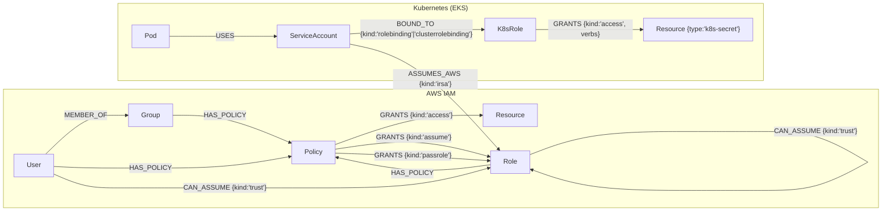
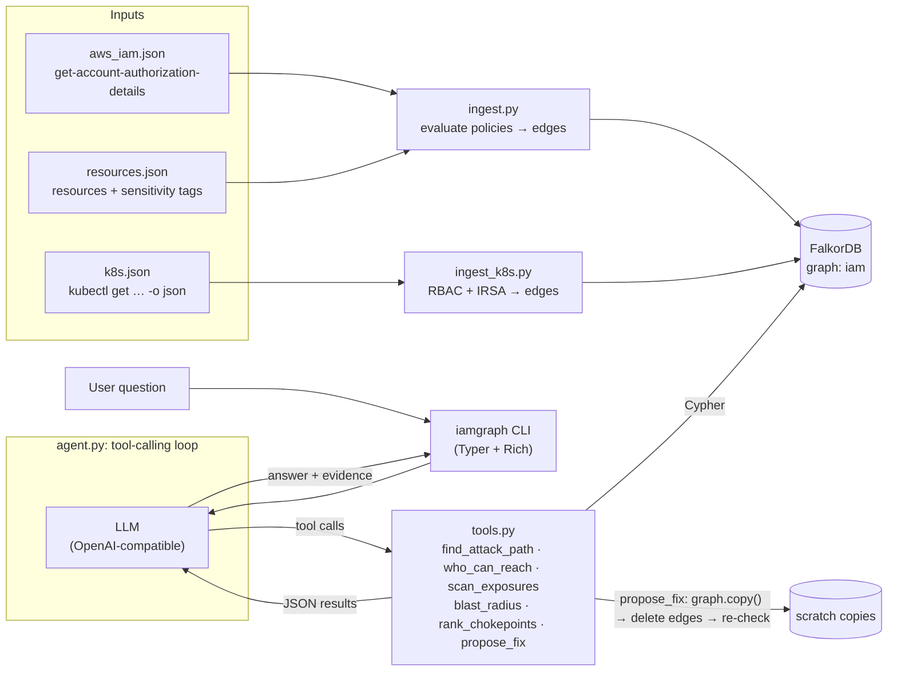
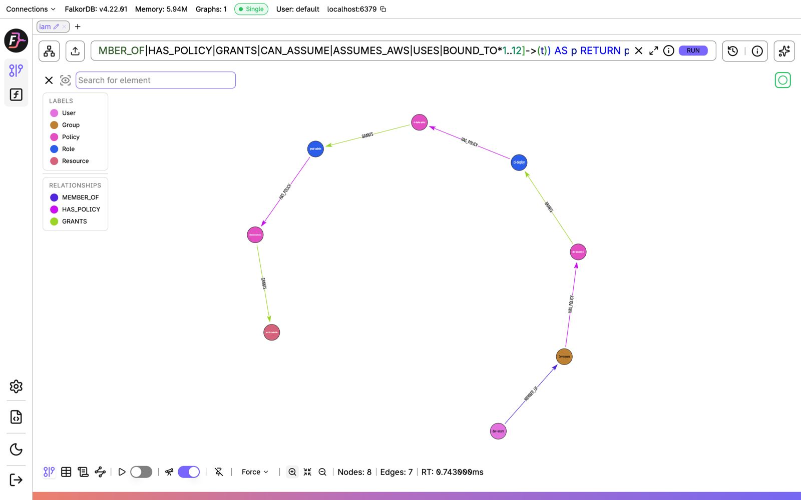
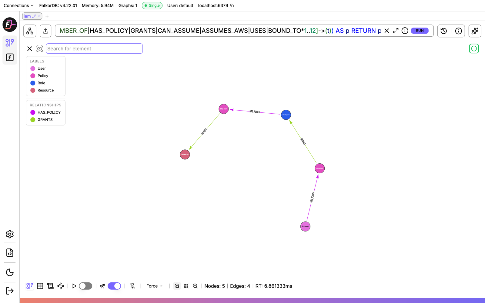
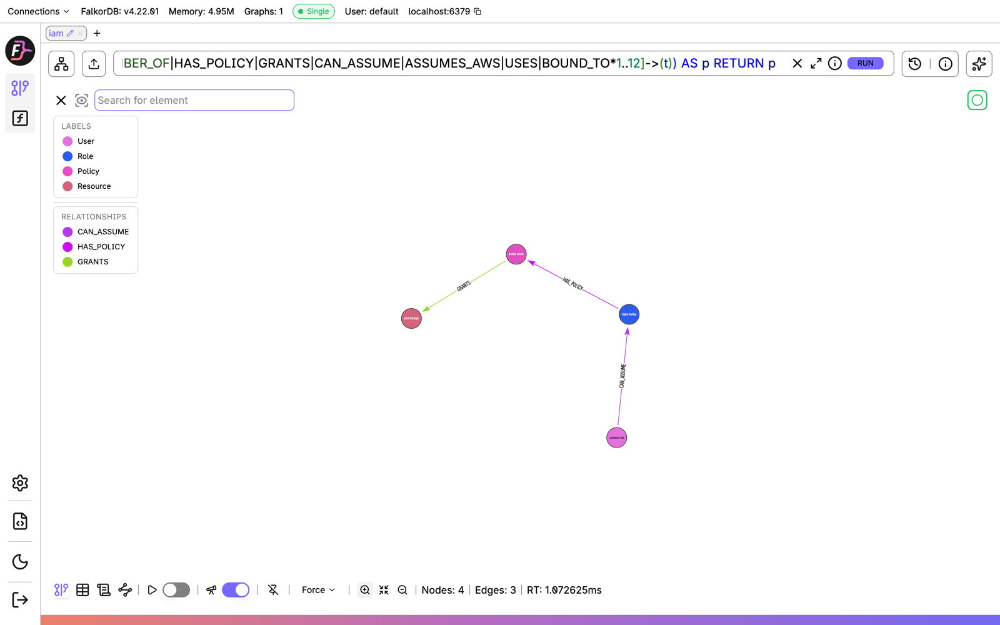
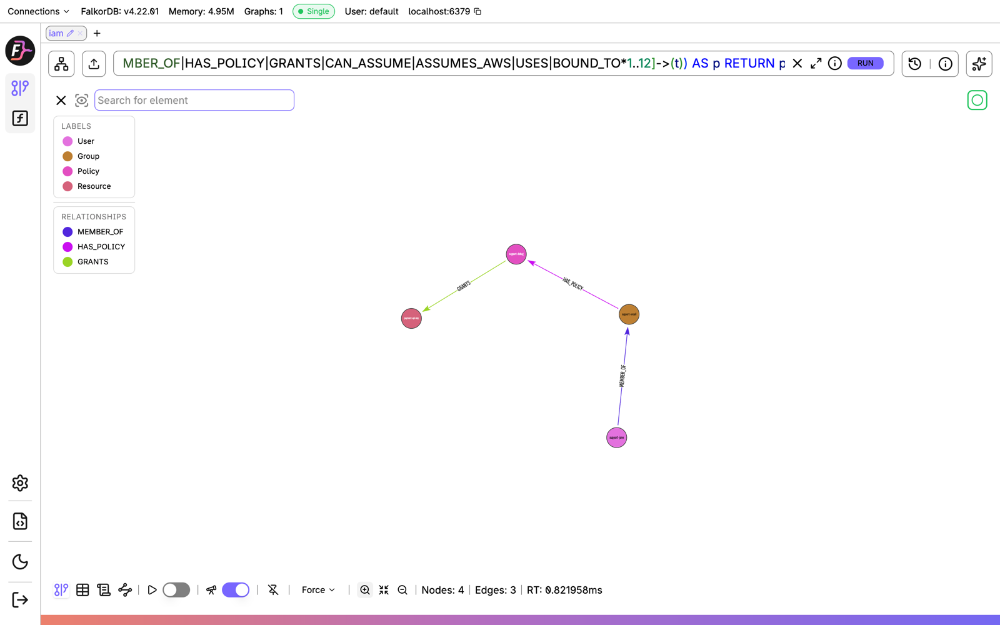
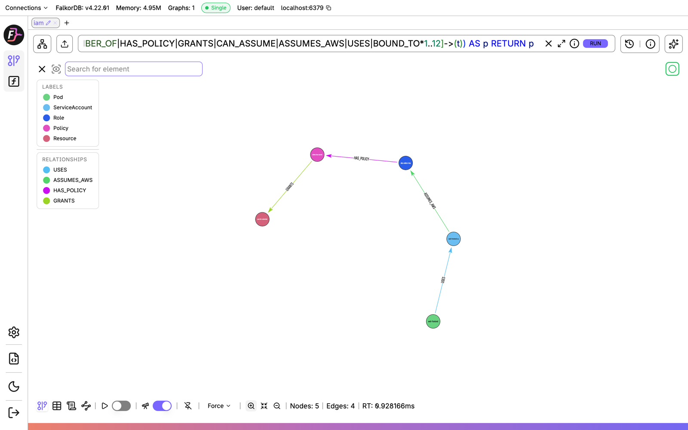
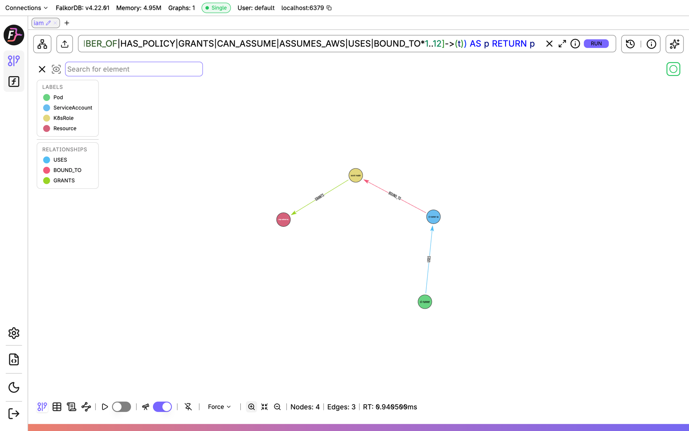

# IAM Attack-Path + Auto-Remediation Agent

> Graph Hacks (WeMakeDevs x FalkorDB) — **Track 01: Agents That Act on Connected Data**

An agent that loads cloud IAM (and Kubernetes RBAC) into a FalkorDB graph, finds multi-hop
privilege-escalation paths, proposes the least-privilege fix that cuts each path, and shows
the traced path as evidence.

## Status
Feature-complete for the hackathon: AWS IAM + Kubernetes RBAC + IRSA bridge, 6 agent tools,
verified remediation, web UI, 23 regression tests.

## Setup

### One command (Docker only)
```bash
cp .env.example .env          # optional: add an OpenAI-compatible key, only needed for `ask`
docker compose run --rm app iamgraph ask "Can dev-intern reach prod-db-credentials? If so, fix it."
docker compose run --rm app iamgraph scan       # no LLM needed
docker compose run --rm app pytest -q
docker compose --profile app up web             # web UI on http://localhost:8000
```
This starts FalkorDB (Browser on http://localhost:3000), builds the app image, loads the
synthetic data into graph `iam`, then runs the command.

### Local (uv)
Requirements: Docker, Python 3.11+, [uv](https://docs.astral.sh/uv/).

```bash
docker compose up -d          # FalkorDB on :6379, Browser on http://localhost:3000
cp .env.example .env          # add your OpenAI-compatible API key (only needed for `ask`)
uv sync
uv run iamgraph ping          # verify FalkorDB connectivity
uv run iamgraph load          # generate synthetic AWS account + EKS cluster, ingest into FalkorDB
```

## Usage

```bash
uv run iamgraph ask "Can dev-intern reach prod-db-credentials? If so, fix it."
uv run iamgraph ask           # interactive agent (lists the golden questions)
uv run iamgraph scan          # every non-admin user / pod reaching sensitive data + chokepoints
uv run iamgraph who prod-db-credentials               # every actor that can reach it, expected vs UNEXPECTED
uv run iamgraph path dev-intern prod-db-credentials   # raw path query, no LLM
uv run iamgraph fix  dev-intern prod-db-credentials   # verified remediation, no LLM
uv run iamgraph path shop/web-frontend prod-db-credentials   # K8s objects accept ns/name
uv run iamgraph web           # web UI on http://localhost:8000 (graph, path + fix, who, scan, agent chat)
uv run iamgraph stats         # node/edge counts
uv run iamgraph generate      # regenerate synthetic data (load only generates if missing)
uv run pytest                 # regression tests against the 6 planted attack paths
```

### Web UI
`iamgraph web` serves a single page (FastAPI + vis-network) over the same tools, so it runs the same Cypher.
It draws the whole graph. The tabs are:
- **Path & fix**: highlights the attack path, shows the chosen cut as a red ✂ edge, and lists the diff, command,
  alternatives considered and the simulated verification.
- **Who can reach**: lists every actor with expected or UNEXPECTED access.
- **Scan**: lists exposures and chokepoints.
- **Ask agent**: LLM chat with the golden questions, showing tool calls and highlighting the path.

## Graph model

**Modeling principle: permissions are edges, not JSON blobs.** Every effective permission
found by evaluating a policy document at ingest time becomes an edge. That includes group
membership, policy attachment, data access, `sts:AssumeRole`, `iam:PassRole`, trust policies,
RBAC bindings and IRSA. An attack path is then just a graph path, and every question the
agent asks ("who can reach X", "what is the blast radius of Y", "which edge is a chokepoint")
is a Cypher traversal. Raw policy documents are kept on `Policy`/`Role`/`K8sRole` nodes **only**
so remediation can show a patched document. No traversal ever reads them.



| Label | Key properties | Source |
|---|---|---|
| `User` | `uid` (ARN), `name`, `team` | `get-account-authorization-details` |
| `Group` | `uid`, `name` | 〃 |
| `Role` | `trusted_services`, `trusts_account`, `oidc_providers`, `irsa_subjects`, `trust_document` | 〃 |
| `Policy` | `managed`, `aws_managed`, `full_admin`, `document` (managed + inline) | 〃 |
| `Resource` | `arn`, `type`, `sensitive` (tag `sensitivity=high`), `namespace` for K8s secrets | resource inventory / `kubectl get secrets` |
| `Pod` | `namespace`, `service_account`, `image`, `expected_access` | `kubectl get pods` |
| `ServiceAccount` | `namespace`, `irsa_role_arn` | `kubectl get sa` |
| `K8sRole` | `namespace` (`''` = cluster-wide), `kind` (Role/ClusterRole), `rules` | `kubectl get roles,clusterroles` |

Every node is keyed by `uid`: the ARN for AWS, `k8s:<namespace>:<kind>:<name>` for Kubernetes.

How edges are derived:

| Edge | Created when |
|---|---|
| `GRANTS {kind:'access'}` | an `Allow` statement's actions apply to the resource's service (excluding `List*`/`Describe*`) and a `Resource` pattern matches its ARN (wildcards via `fnmatch`) |
| `GRANTS {kind:'assume'}` | the statement allows `sts:AssumeRole` on the role **and** the role's trust policy delegates to the account root |
| `GRANTS {kind:'passrole'}` | `iam:PassRole` on a role trusted by `lambda`/`ec2` **and** the same policy allows `lambda:CreateFunction`/`ec2:RunInstances` |
| `CAN_ASSUME {kind:'trust'}` | a role's trust policy names the user/role ARN explicitly (no identity policy needed) |
| `USES` | the pod's `spec.serviceAccountName` |
| `BOUND_TO` | a (Cluster)RoleBinding lists the SA as a subject. A ClusterRole bound by a *RoleBinding* gets its own namespaced `K8sRole` node that only reaches that namespace |
| K8s `GRANTS` | a rule allows `get`/`list`/`watch` on `secrets` (honouring `resourceNames` and namespace scope) |
| `ASSUMES_AWS` | the SA's `eks.amazonaws.com/role-arn` annotation names the role **and** the role's OIDC trust `sub` condition matches `system:serviceaccount:<ns>:<sa>`. Both must hold, as in real IRSA |

### Supported semantics and limitations
- **Allow-only.** `Deny` statements, `Condition` blocks (except the IRSA `…:sub` condition),
  `NotAction` and `NotResource` are ignored. Permission boundaries, SCPs, session policies
  and resource-based policies (S3 bucket / KMS key policies) are not modeled.
- Results therefore **over-approximate** reachability. A reported path is a candidate to review,
  and a missing path is strong evidence of no access only within this model.
- `PassRole` escalation is modeled for Lambda and EC2 only.
- Kubernetes: only `secrets` read rules become edges. Users/groups as RBAC subjects, pod `exec`,
  `create pods` escalation and node-level access are out of scope.
- Data is a seeded synthetic account and cluster (`iamgraph generate`) in the real API shapes,
  so a real `aws iam get-account-authorization-details` / `kubectl get … -o json` dump can be
  ingested the same way.

## Cypher this project depends on

All agent tools live in `src/iamgraph/tools.py` and each one is a Cypher query. Below are the real
queries, with the Python constants filled in: `REL` = `MEMBER_OF|HAS_POLICY|GRANTS|CAN_ASSUME|ASSUMES_AWS|USES|BOUND_TO`
and `MAX_HOPS` = 12 (written `:REL` below for brevity). The same traversal set covers AWS and Kubernetes, so a pod→AWS path needs
no special code.

**`find_attack_path`: the k shortest escalation chains** (`SPPATHS_Q`). `algo.SPpaths` returns
several alternative paths, not just one, so the agent can show that cutting one route isn't enough.
```cypher
MATCH (s {uid: $src}), (t:Resource {uid: $dst})
CALL algo.SPpaths({sourceNode: s, targetNode: t,
                   relTypes: ["MEMBER_OF","HAS_POLICY","GRANTS","CAN_ASSUME","ASSUMES_AWS","USES","BOUND_TO"],
                   relDirection: 'outgoing', pathCount: $k, maxLen: 12})
YIELD path, pathWeight
RETURN [n IN nodes(path) | {label: labels(n)[0], name: n.name, uid: n.uid, ...}] AS nodes,
       [e IN relationships(path) | {id: id(e), type: type(e), kind: e.kind, sid: e.sid, actions: e.actions, ...}] AS edges
ORDER BY pathWeight
```

**Single shortest path** (`SHORTEST_Q`), used inside the fix loop. FalkorDB only accepts
`shortestPath` in `WITH`/`RETURN`.
```cypher
MATCH (s {uid: $src}), (t:Resource {uid: $dst})
WITH shortestPath((s)-[:MEMBER_OF|HAS_POLICY|GRANTS|CAN_ASSUME|ASSUMES_AWS|USES|BOUND_TO*1..12]->(t)) AS p
WHERE p IS NOT NULL
RETURN nodes(p), relationships(p)   -- same projection as above
```

**`who_can_reach`: every actor that can reach one resource.** This is a shortest path from each
user/pod to the target. ServiceAccounts that a pod runs as are skipped, because the pod already
represents them.
```cypher
MATCH (t:Resource {uid: $dst}), (s)
WHERE s:User OR s:Pod OR (s:ServiceAccount AND NOT (:Pod)-[:USES]->(s))
WITH s, t, shortestPath((s)-[:REL*1..12]->(t)) AS p
WHERE p IS NOT NULL
RETURN labels(s)[0], s.name, s.uid, s.namespace, t.name IN coalesce(s.expected_access, []), length(p) AS hops
ORDER BY hops, s.name
```

**`scan_exposures`: all-pairs exposure scan.** Covers every non-admin user, and every pod reaching a
sensitive resource it didn't declare in its `expected-access` annotation.
```cypher
MATCH (s), (t:Resource {sensitive: true})
WHERE (s:User AND NOT s.uid IN $admins) OR (s:Pod AND NOT t.name IN coalesce(s.expected_access, []))
WITH s, t, shortestPath((s)-[:REL*1..12]->(t)) AS p
WHERE p IS NOT NULL
RETURN labels(s)[0], s.name, t.name, length(p) AS hops, nodes(p), relationships(p)
```
`$admins` comes from:
```cypher
MATCH (u:User)-[:MEMBER_OF*0..1]->()-[:HAS_POLICY]->(p:Policy {full_admin: true})
RETURN collect(DISTINCT u.uid)
```

**`blast_radius`: everything one principal can reach** (variable-length traversal).
```cypher
MATCH (s {uid: $uid})-[:REL*1..12]->(x)
WHERE x:Resource OR x:Role
RETURN DISTINCT labels(x)[0] AS type, x.name, x.sensitive ORDER BY type, x.name
```

**`rank_chokepoints`: betweenness centrality.** Finds the roles/policies/groups that the most
paths flow through. `algo.betweenness` errors on relationship types that don't exist, so the
list is first filtered through `CALL db.relationshipTypes()`. The algorithm samples random source
nodes (by default 32, with a time-based seed), so we sample every node with a fixed seed to get stable rankings.
```cypher
CALL algo.betweenness({relationshipTypes: [...TRAVERSAL types present in the graph...],
                       samplingSize: $nodes, samplingSeed: 42})
YIELD node, score
WHERE (node:Role OR node:Policy OR node:Group) AND score > 0
RETURN labels(node)[0], node.name, score ORDER BY score DESC LIMIT $limit
```
plus the most-exposed resources:
```cypher
MATCH (t:Resource {sensitive: true})<-[:REL*1..12]-(s:User)
WHERE NOT s.uid IN $admins
RETURN t.name, count(DISTINCT s) AS users ORDER BY users DESC LIMIT $limit
```

**`_reach`: the reachability snapshot** that every candidate fix is scored against. It runs twice:
once for all access, and once for "legit" access that doesn't go through a full-admin policy.
Losing access that only exists via an admin policy *is* the bug, so it doesn't count as collateral.
```cypher
MATCH (p) WHERE p:User OR p:Role OR p:Pod
MATCH path = (p)-[:REL*1..12]->(r:Resource)
WHERE none(n IN nodes(path) WHERE n:Policy AND n.full_admin)   -- "legit" variant only
RETURN DISTINCT labels(p)[0], p.uid, r.uid
```

### `propose_fix`: simulate on a graph copy, then verify
The fix is computed on the graph itself, not by asking the LLM to guess:

1. `graph.copy()` makes a scratch graph, so the live `iam` graph is never changed (a test checks this).
   Edge ids survive the copy.
2. Take the shortest path in the scratch graph. Each edge on it becomes a candidate fix with a
   concrete meaning:

   | Edge | Fix |
   |---|---|
   | `MEMBER_OF` | `remove_from_group` |
   | `HAS_POLICY` | `detach_policy` |
   | `CAN_ASSUME` | `edit_trust_policy` |
   | Policy `GRANTS` | `narrow_statement` |
   | `ASSUMES_AWS` | `remove_irsa_binding` |
   | `BOUND_TO` | `delete_rolebinding` |
   | K8sRole `GRANTS` | `narrow_rbac_rule` |

   Narrowing a wildcard statement removes *every* sensitive edge that statement produced, not just
   the one on this path. `USES` (pod → SA) is never cut.
3. For each candidate: copy the scratch graph again, `MATCH ()-[e]->() WHERE id(e) IN $ids DELETE e`,
   run `_reach`, and compare with the snapshot taken before. The result is **exposures removed**
   vs **collateral** (legitimate access lost; a role's access counts 3×).
   Score = `collateral − 2·exposures`.
4. Apply the lowest-scoring cut to the scratch graph and repeat until `shortestPath` returns nothing
   (up to 4 rounds). Return `verified_no_path_after_fix`, plus the AWS CLI / `kubectl` command and a
   before/after policy, trust-policy or RBAC YAML diff.

### Why FalkorDB is load-bearing
- **Escalation is a path problem.** Role chaining, PassRole, stale trust and IRSA→AWS are all
  multi-hop and mix edge types. In SQL or a policy simulator each hop is a separate lookup. Here it's
  one variable-length `shortestPath` / `algo.SPpaths` call.
- **Graph algorithms answer the "where should I fix it?" question.** Betweenness centrality picks out the
  shared chokepoints (here the `prod-admin` and `ci-deploy` roles behind the role chain) that no single policy document reveals.
- **`graph.copy()` makes the what-if analysis cheap.** Each candidate fix is tried on a throwaway copy
  and checked by re-running the same reachability queries, so the recommended fix is *verified*, not guessed.
- **One graph for two systems.** AWS IAM and Kubernetes RBAC share a single graph through the
  `ASSUMES_AWS` edge, so the pod-to-AWS-secret path is found by the same, unchanged query.

## Architecture



- **The LLM never makes up the evidence.** Every path, count and fix comes from a tool result.
  The CLI renders each tool call (path tree, fix panel, JSON/YAML diff) next to the LLM's answer,
  so the evidence is visible.
- **Acts, not just answers.** `propose_fix` returns the exact `aws iam …` / `kubectl …` commands
  and patched documents, and only after re-running the path query on a simulated graph to confirm
  the path is gone.
- Every subcommand except `ask` is deterministic and needs no LLM (`path`, `who`, `fix`, `scan`),
  which makes it handy for demos and tests.

## Demo

Track: **01 · Agents That Act on Connected Data**.

The synthetic account and cluster include 6 planted attack paths among benign noise
(24 users, 21 roles, 13 pods, 155 nodes / 206 edges):

| Planted path | Source → target | Escalation |
|---|---|---|
| role-chain | `dev-intern` → `prod-db-credentials` | Developers → `ci-*` AssumeRole → ci-deploy → prod-admin (Admin) |
| passrole-lambda | `data-analyst` → `customer-pii` | `iam:PassRole *` + `lambda:CreateFunction` → lambda-billing-exporter |
| stale-trust | `contractor-bob` → `prod-backups` | legacy-backup trust policy still names the contractor |
| wildcard-secrets | `support-jane` → `payment-api-key` | `secretsmanager:GetSecretValue` on `*` |
| irsa-wildcard | pod `web-frontend` → `prod-db-credentials` | SA annotated with `eks-orders-irsa`, whose trust `sub` is `shop:*` |
| k8s-secrets-cluster | pod `ci-runner` → `stripe-webhook-key` | ClusterRoleBinding → ClusterRole `secret-reader` (all namespaces) |

Golden questions (shown by interactive `iamgraph ask`):
```text
Can dev-intern reach prod-db-credentials? If so, fix it.
Can the web-frontend pod reach prod-db-credentials?
Can the ci-runner pod read stripe-webhook-key? Fix it.
Scan the account and cluster: what is exposed, and where are the chokepoints?
Who can access customer-pii?
```

Sample output, role chaining (`iamgraph path dev-intern prod-db-credentials`):
```text
Path 1 (7 hops) — traced in FalkorDB
└── User: dev-intern
    └── --MEMBER_OF--> Group: Developers
        └── --HAS_POLICY--> Policy: dev-assume-ci
            └── --GRANTS (assume) Sid=AssumeCIRoles sts:AssumeRole--> Role: ci-deploy
                └── --HAS_POLICY--> Policy: ci-deploy-policy
                    └── --GRANTS (assume) Sid=DeployToProd sts:AssumeRole--> Role: prod-admin
                        └── --HAS_POLICY--> Policy: AdministratorAccess
                            └── --GRANTS (access) Sid=stmt0--> Resource: prod-db-credentials SENSITIVE
```

Cross-boundary fix, pod → AWS (`iamgraph fix web-frontend prod-db-credentials`):
```text
╭─ Fix #1 ───────────────────────────────────────────────────────────────────────────────╮
│ Stop shop/web-frontend-sa from assuming AWS role eks-orders-irsa (remove the IRSA      │
│ annotation and narrow trust sub `system:serviceaccount:shop:*`)                        │
│ Cuts: web-frontend-sa -[ASSUMES_AWS]-> eks-orders-irsa                                 │
│ Exposures removed: 2   Legit access lost: none                                         │
╰────────────────────────────────────────────────────────────────────────────────────────╯
--- trust-policy:eks-orders-irsa (current)
+++ trust-policy:eks-orders-irsa (fixed)
-          "oidc.eks.us-east-1.amazonaws.com/id/EXAMPLE:sub": "system:serviceaccount:shop:*"
+          "oidc.eks.us-east-1.amazonaws.com/id/EXAMPLE:sub": "system:serviceaccount:shop:orders-api-sa"
kubectl annotate serviceaccount web-frontend-sa -n shop eks.amazonaws.com/role-arn-
aws iam update-assume-role-policy --role-name eks-orders-irsa --policy-document file://trust.json
  verified on simulated graph: path is gone
```
The legitimate `orders-api` pod keeps its IRSA access, because the fix replaces the wildcard with
the service accounts that should still be trusted.

### The planted paths in FalkorDB Browser
Open http://localhost:3000, log in with the defaults, select graph `iam`, and run the query
(change the source label/name and the target):
```cypher
MATCH (s:User {name:'dev-intern'}), (t:Resource {name:'prod-db-credentials'})
WITH shortestPath((s)-[:MEMBER_OF|HAS_POLICY|GRANTS|CAN_ASSUME|ASSUMES_AWS|USES|BOUND_TO*1..12]->(t)) AS p
RETURN p
```

| role-chain: `dev-intern` → `prod-db-credentials` (7 hops) | passrole-lambda: `data-analyst` → `customer-pii` |
|---|---|
|  |  |
| **stale-trust: `contractor-bob` → `prod-backups`** | **wildcard-secrets: `support-jane` → `payment-api-key`** |
|  |  |
| **irsa-wildcard: Pod `web-frontend` → AWS `prod-db-credentials`** (`(s:Pod {name:'web-frontend'})`) | **k8s-secrets-cluster: Pod `ci-runner` → `stripe-webhook-key`** |
|  |  |

Screenshots are regenerated with `node scripts/screenshots.mjs` (Playwright + local Chrome).

## AI assistance disclosure
An AI coding assistant was used for planning and code generation. All code was
reviewed and understood by the author, who can explain the graph model, Cypher, and
architecture.

## License
MIT
